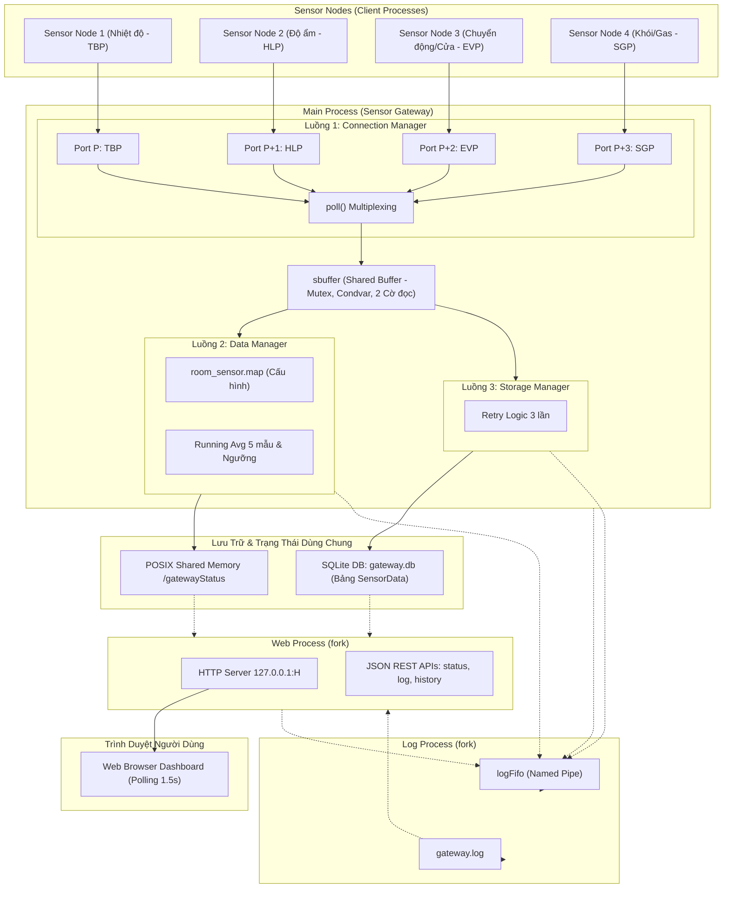

# BÀI TẬP GIỮA KỲ: SENSOR GATEWAY – SMART HOME MONITORING SYSTEM
**Môn học:** Lập trình Linux Nhúng (Embedded Linux Programming)  
**Đơn vị đào tạo:** DevLinux Academy  
**Tác giả thực hiện:** Sinh viên năm 4 chuyên ngành Kỹ thuật Máy tính / Hệ thống Nhúng  
**Môi trường thử nghiệm:** Linux x86_64 / GCC 9+ / SQLite 3.3x / POSIX.1-2008  

---

## MỤC LỤC
1. [Giới Thiệu Tổng Quan Dự Án](#1-giới-thiệu-tổng-quan-dự-án)
2. [Kiến Trúc Hệ Thống & Sơ Đồ Khối](#2-kiến-trúc-hệ-thống--sơ-đồ-khối)
3. [Cấu Trúc Thư Mục & Tổ Chức Mã Nguồn](#3-cấu-trúc-thư-mục--tổ-chức-mã-nguồn)
4. [Thiết Kế Kỹ Thuật Chi Tiết](#4-thiết-kế-kỹ-thuật-chi-tiết)
   - 4.1 Hàng đợi sbuffer an toàn luồng (Two-Reader Queue)
   - 4.2 Lớp Protocol Adapter & 4 Giao thức Cảm biến
   - 4.3 Connection Manager (Non-blocking I/O với `poll()`)
   - 4.4 Data Manager (Trung bình trượt, bảng phòng-sensor & ngưỡng cảnh báo)
   - 4.5 Storage Manager (SQLite WAL Mode, Reconnection & Retry)
   - 4.6 Log Process & Named Pipe (FIFO nguyên tử)
   - 4.7 Web Server Process & Web Dashboard
   - 4.8 POSIX Shared Memory & Robust Process-Shared Mutex
5. [Hướng Dẫn Biên Dịch & Chạy Chương Trình](#5-hướng-dẫn-biên-dịch--chạy-chương-trình)
6. [Bằng Chứng Kiểm Chứng Thực Nghiệm (Step 0 – Step 12)](#6-bằng-chứng-kiểm-chứng-thực-nghiệm-step-0--step-12)
7. [Giải Trình Toàn Diện 13 Câu Hỏi Bảo Vệ Chuyên Sâu](#7-giải-trình-toàn-diện-13-câu-hỏi-bảo-vệ-chuyên-sâu)
8. [Kịch Bản Thuyết Trình & Quay Video Demo](#8-kịch-bản-thuyết-trình--quay-video-demo)

---

## 1. Giới Thiệu Tổng Quan Dự Án

Dự án xây dựng một **Sensor Gateway** trên nền tảng hệ điều hành **Linux** bằng ngôn ngữ **C (chuẩn C99 / POSIX)** để giám sát thông số môi trường của các phòng trong tòa nhà thông minh (Smart Home). Hệ thống đóng vai trò cầu nối thu nhận dữ liệu từ nhiều sensor node độc lập, giải mã đa giao thức, phân tích xử lý thời gian thực, lưu trữ bền vững vào cơ sở dữ liệu SQLite, ghi log tập trung và cung cấp giao diện trực quan cho người dùng qua Web Dashboard.

Hệ thống đáp ứng 5 chức năng cốt lõi:
1. **Thu nhận đa luồng (Reception):** Kết nối TCP socket đồng thời tới nhiều sensor node trên 4 cổng liên tiếp `[P .. P+3]`. Số lượng node động, không giới hạn cứng.
2. **Xử lý & Cảnh báo (Processing & Alerts):** Lọc nhiễu bằng thuật toán trung bình trượt (*Running Average*) 5 mẫu cho Nhiệt độ và Độ ẩm, so sánh ngưỡng, phát hiện sự kiện tức thời (Chuyển động, Cửa mở/đóng, Báo động khói/khí gas), và xác thực tính hợp lệ của sensor node theo file ánh xạ `room_sensor.map`.
3. **Lưu trữ bền vững (Storage):** Ghi toàn bộ dữ liệu chuẩn hóa vào bảng `SensorData` trong SQLite với chế độ WAL (Write-Ahead Logging). Tự động phục hồi kết nối (tối đa 3 lần thử) khi gặp sự cố mạng hoặc khóa file.
4. **Ghi nhật ký tập trung (Centralized Logging):** Thu gom log-event từ tất cả các luồng và tiến trình con về một tiến trình `log process` chuyên trách qua đường ống có tên (`logFifo`) với cơ chế ghi nguyên tử (`PIPE_BUF`), đánh số thứ tự tuần tự không gián đoạn vào file `gateway.log`.
5. **Hiển thị trực quan (Web Dashboard):** Web server chạy trên một tiến trình độc lập (`web process`) với quyền chỉ đọc (*read-only*), giao diện HTML5/CSS/JavaScript tự làm mới mỗi 1.5 giây, biểu đồ trực tiếp và bộ lọc log, đảm bảo tính sẵn sàng cao ngay cả khi có sự cố giao diện.

---

## 2. Kiến Trúc Hệ Thống & Sơ Đồ Khối

Hệ thống được thiết kế theo mô hình **Đa tiến trình kết hợp Đa luồng (Multi-Process & Multi-Threading)**:
- **03 Tiến trình (Processes):**
  1. `Main Process`: Khởi tạo hệ thống, chạy 3 luồng lõi, quản lý vòng đời và tài nguyên.
  2. `Log Process` (fork từ Main): Đọc FIFO và ghi file `gateway.log`.
  3. `Web Process` (fork từ Main): Lắng nghe HTTP request trên cổng `HTTP_PORT`, phục vụ trang web và REST API JSON.
- **03 Luồng trong Main Process (Threads):**
  1. `Connection Manager Thread`: Lắng nghe 4 cổng TCP socket (`P`, `P+1`, `P+2`, `P+3`), giải mã gói tin qua `protocol_adapter` và đưa vào `sbuffer`.
  2. `Data Manager Thread`: Đọc `sbuffer`, tra cứu `room_sensor.map`, tính trung bình trượt, phát hiện bất thường, cập nhật Shared Memory.
  3. `Storage Manager Thread`: Đọc `sbuffer`, ghi bản ghi vào cơ sở dữ liệu SQLite.
- **IPC & Đồng bộ hóa:**
  - `sbuffer`: Hàng đợi liên kết đơn an toàn luồng với `pthread_mutex_t` và `pthread_cond_t`.
  - `logFifo`: POSIX Named Pipe giao tiếp giữa các luồng/web process và log process.
  - `gatewayStatus`: POSIX Shared Memory (`shm_open`, `mmap`) đồng bộ qua Mutex liên tiến trình `PTHREAD_PROCESS_SHARED` có thuộc tính `PTHREAD_MUTEX_ROBUST`.

### Sơ Đồ Khối Tổng Thể (Architecture Block Diagram)



---

## 3. Cấu Trúc Thư Mục & Tổ Chức Mã Nguồn

Dự án được phân bổ khoa học theo cấu trúc chuẩn dự án phần mềm nhúng Linux:

```
c:\Users\Asus\Documents\Assignment_dev_linux/
├── include/                   # Header files mô tả kiểu dữ liệu và giao diện module
│   ├── sensor_types.h         # Kiểu dữ liệu chuẩn hóa sensor_data_t, sensor_type_t (Mục 3.2)
│   ├── sensor_config.h        # Macro cấu hình độ dài lọc trung bình & ngưỡng (Mục 3.3)
│   ├── protocol_adapter.h     # Giao diện parser & reply của Protocol Adapter (Mục 3.5)
│   ├── sbuffer.h              # Hàng đợi sbuffer với cơ chế 2 cờ đọc an toàn luồng (Mục 3.9)
│   ├── connmgr.h              # Connection Manager: socket 4 cổng & poll loop (Mục 3.10)
│   ├── datamgr.h              # Data Manager: phòng-sensor, running avg & cảnh báo (Mục 3.10)
│   ├── storagemgr.h           # Storage Manager: SQLite3, WAL mode & auto reconnect (Mục 3.10)
│   ├── shared_status.h        # POSIX Shared Memory & Robust Mutex liên tiến trình (Mục 3.11)
│   ├── log_process.h          # Tiến trình Log, FIFO và hàm ghi log nguyên tử (Mục 3.8)
│   ├── web_server.h           # Tiến trình Web HTTP Server & JSON serialization (Step 9)
│   └── gateway.h              # Ngữ cảnh gốc toàn cục của Main Process (Mục 3.11)
├── src/                       # Mã nguồn hiện thực chi tiết (.c)
│   ├── main.c                 # Entry point: fork tiến trình, chạy thread, signal handler
│   ├── sbuffer.c              # Hiện thực sbuffer (insert, 2-reader read, purge, condvar)
│   ├── protocol_adapter.c     # Hiện thực parser TBP, HLP, EVP, SGP & CRC-16/CCITT-FALSE
│   ├── connmgr.c              # Hiện thực quản lý kết nối TCP, non-blocking I/O multiplexing
│   ├── datamgr.c              # Hiện thực logic phân tích dữ liệu, handler table, alert transitions
│   ├── storagemgr.c           # Hiện thực lưu trữ SQLite3 và xử lý mất kết nối
│   ├── shared_status.c        # Hiện thực POSIX shm_open, mmap và robust mutex
│   ├── log_process.c          # Hiện thực log process, mkfifo, đọc/ghi FIFO ra gateway.log
│   ├── web_server.c           # Hiện thực HTTP server, router, endpoint JSON và xử lý SIGPIPE
│   └── sensor_node.c          # Trình giả lập sensor node (--fragment, --glue, --corrupt)
├── web/
│   └── index.html             # Giao diện Web Dashboard độc lập, không cần Internet
├── test/                      # Bộ kiểm thử đơn vị và kịch bản thực nghiệm
│   ├── test_crc.c             # Kiểm thử vector chuẩn CRC-16 ("123456789" & gói mẫu đề bài)
│   ├── test_adapters.c        # Kiểm thử 4 adapter, phân mảnh, dính frame và frame hỏng
│   ├── test_sbuffer.c         # Kiểm thử đa luồng hàng đợi sbuffer với 1 writer và 2 reader
│   ├── run_all_tests.sh       # Kịch bản bash chạy toàn bộ unit test
│   └── run_simulation.sh      # Kịch bản bash mô phỏng 5 node hoạt động liên tục
├── room_sensor.map            # File cấu hình ánh xạ phòng và sensor ID (Mục 3.6)
├── Makefile                   # Quy trình build tự động (make, debug, test, valgrind, helgrind)
└── README.md                  # Tài liệu báo cáo kỹ thuật toàn diện đồ án
```

---

## 4. Thiết Kế Kỹ Thuật Chi Tiết

### 4.1 Hàng Đợi sbuffer An Toàn Luồng (Two-Reader Queue)
- **Vấn đề kỹ thuật:** Cả 2 luồng `Data Manager` và `Storage Manager` đều cần đọc toàn bộ luồng phép đo từ `Connection Manager`. Nếu dùng 2 buffer riêng biệt sẽ tốn gấp đôi bộ nhớ và vi phạm quy định của đề tài (*"Chỉ dùng một sbuffer duy nhất để chia sẻ phép đo giữa ba thread; giải pháp dùng nhiều buffer không được chấp nhận"*).
- **Giải pháp thiết kế:**
  Mỗi phần tử trong danh sách liên kết đơn `sbuffer_node_t` được trang bị 2 cờ logic:
  - `bool read_by_data`: Đánh dấu Data Manager đã đọc phần tử này.
  - `bool read_by_storage`: Đánh dấu Storage Manager đã đọc phần tử này.
- **Cơ chế thu hồi (Purge):**
  Một nút **CHỈ** được gỡ khỏi danh sách và giải phóng bộ nhớ (`free(node)`) khi:
  ```c
  (node->read_by_data == true) && (node->read_by_storage == true)
  ```
  Do mỗi luồng đọc tiến hành tuần tự theo thứ tự FIFO từ đầu danh sách chưa đọc của mình, nút đầu hàng đợi (`sbuf->head`) sẽ được giải phóng ngay khi luồng đọc chậm hơn hoàn thành đọc nút đó. Hàm `sbuffer_purge_read_nodes` kiểm tra và dọn dẹp các nút đã thỏa mãn cả hai cờ một cách triệt để.
- **Đồng bộ hóa không bận (No Busy-Polling):**
  - Sử dụng `pthread_cond_t not_empty` kết hợp với `pthread_mutex_t lock`.
  - Luồng reader bị chặn (`pthread_cond_wait`) khi không còn phần tử mới chưa đọc, đưa luồng vào trạng thái Sleep của kernel (CPU tiêu thụ = 0%).
  - Khi Writer chèn dữ liệu (`sbuffer_insert`) hoặc khi Gateway dừng (`sbuffer_shutdown`), hàm `pthread_cond_broadcast(&sbuf->not_empty)` được gọi để đánh thức tất cả các reader.

---

### 4.2 Lớp Protocol Adapter & 4 Giao Thức Cảm Biến

Đặc tả 4 giao thức được cô lập hoàn toàn trong lớp `protocol_adapter.c` thông qua con trỏ hàm:

| Giao thức | Cảm biến | Cổng | Phân khung | Mã hóa | Phản hồi | Đặc điểm kỹ thuật |
| :--- | :--- | :--- | :--- | :--- | :--- | :--- |
| **TBP** | Nhiệt độ | P | Cố định 18 byte | Nhị phân, Little-Endian | Không | Gọn nhẹ; float 64-bit IEEE 754 giải mã qua `uint64_t` và `memcpy`. |
| **HLP** | Độ ẩm | P+1 | Kết thúc `\n` (max 64B) | ASCII text | Không | Cú pháp `HUM <id> <value> <ts>\n`, dễ kiểm thử bằng `netcat`. |
| **EVP** | Chuyển động, Cửa | P+2 | TLV (Type-Length-Value) | Nhị phân, Big-Endian | Không | Giao thức sự kiện; Type 0x01 (Motion, 8B), Type 0x02 (Door, 9B). |
| **SGP** | Khói / Gas | P+3 | Cố định 11 byte | Nhị phân, Big-Endian, CRC-16 | ACK/NAK | Khung bắt đầu bằng Magic `0x7E`. Kiểm tra CRC-16/CCITT-FALSE 8 byte payload. Phản hồi 1 byte: ACK (`0x06`) hoặc NAK (`0x15`). |

#### Thuật Toán CRC-16/CCITT-FALSE
- Đa thức sinh: x¹⁶ + x¹² + x⁵ + 1 (giá trị hex: `0x1021`)
- Giá trị khởi tạo: `0xFFFF`
- Không đảo bit đầu vào và đầu ra (`RefIn = false`, `RefOut = false`), `XorOut = 0x0000`.
- Vector kiểm tra chuẩn: chuỗi ASCII `"123456789"` sinh ra mã `0x29B1`.
- Vector trong gói tin mẫu SGP: `id=50, ppm=120, ts=1767225600` sinh ra mã `0xACF5`.

---

### 4.3 Connection Manager (Non-blocking I/O với `poll()`)
- Sử dụng lời gọi hệ thống `poll()` để giám sát đồng thời:
  - 04 listening socket cho 4 cổng P .. P+3.
  - Tối đa `MAX_CONN = 64` socket kết nối từ các sensor node.
- **Giải quyết phân mảnh (TCP Fragmentation) & dính gói (TCP Glueing):**
  - Mỗi kết nối có một bộ đệm riêng `rx[RX_BUF_SIZE]`.
  - Sau mỗi lệnh `recv()`, gọi lặp `adapter->parse()`:
    - Nếu trả về `PARSE_OK`: ghi vào `sbuffer`, dịch các byte còn lại về đầu buffer và tiếp tục phân tích gói tiếp theo trong cùng đợt nhận (giải quyết triệt để **TCP Glueing**).
    - Nếu trả về `PARSE_NEED_MORE`: giữ nguyên các byte đã nhận trong buffer, đợi đợt `recv()` tiếp theo để ghép đủ khung (giải quyết triệt để **TCP Fragmentation**).
    - Nếu trả về `PARSE_ERROR`: ghi log cảnh báo frame hỏng, gửi NAK (nếu là SGP), dịch bỏ byte hỏng để tái đồng bộ.
- **Quy ước nhận diện Sensor Node:**
  - Cổng socket quyết định giao thức.
  - Sensor ID chỉ được biết sau frame hợp lệ đầu tiên. Ngay sau khi giải mã thành công frame đầu, hệ thống ghi log:  
    `A sensor node with <sensorNodeID> has opened a new connection`
  - Khi sensor ngắt kết nối (nhận EOF trên socket), hệ thống ghi log:  
    `The sensor node with <sensorNodeID> has closed the connection`

---

### 4.4 Data Manager (Trung Bình Trượt & Ngưỡng Cảnh Báo)
- **Nạp cấu hình tĩnh:** Nạp file `room_sensor.map` một lần duy nhất khi khởi động.
- **Xác thực dữ liệu:**
  - Nếu `sensor_id` không tồn tại trong bảng cấu hình, hoặc loại cảm biến nhận được không khớp với cấu hình, Data Manager ghi log:  
    `Received sensor data with invalid sensor node ID <node-ID>`
- **Xử lý theo từng loại cảm biến (Bảng Handler Table):**
  - **Nhiệt độ (Type 1) & Độ ẩm (Type 2):** Sử dụng mảng xoay vòng (*Circular Buffer*) có độ dài `RUN_AVG_LENGTH = 5` để tính giá trị trung bình trượt (`running_avg`). Chỉ so sánh ngưỡng khi đã đủ 5 mẫu:
    - Nhiệt độ: `< 15.0°C` (quá lạnh), `> 20.0°C` (quá nóng).
    - Độ ẩm: `< 30.0%` (quá khô), `> 70.0%` (quá ẩm).
  - **Chuyển động (Type 3) & Cửa (Type 4):** Xử lý sự kiện tức thời: cửa mở/đóng, phát hiện chuyển động.
  - **Khói / Gas (Type 5):** So sánh ngưỡng tức thời `>= 300 ppm` để phát báo động ngay lập tức (không lấy trung bình vì độ trễ an toàn quan trọng hơn lọc nhiễu).
- **Chống spam log:** Chỉ phát sinh log khi cảm biến **chuyển trạng thái sang cảnh báo** (`STATE_ALERT`), không ghi lặp lại ở mọi phép đo khi vẫn đang trong vùng cảnh báo.

---

### 4.5 Storage Manager (SQLite WAL Mode & Auto Reconnect)
- **Khởi tạo & cấu hình:** Kết nối tới `gateway.db`. Bật chế độ `PRAGMA journal_mode=WAL;` và đặt `sqlite3_busy_timeout` 2 giây. Chế độ WAL cho phép Web Process đọc cơ sở dữ liệu đồng thời mà không bị chặn bởi thao tác ghi của Storage Manager.
- **Tạo bảng:** Tự động tạo bảng nếu chưa có:
  ```sql
  CREATE TABLE IF NOT EXISTS SensorData (
      id INTEGER NOT NULL,
      type INTEGER NOT NULL,
      value REAL NOT NULL,
      ts INTEGER NOT NULL
  );
  ```
  Ghi log: `Connection to SQL server established.` và `New table SensorData created.`.
- **Cơ chế chịu lỗi (Fault Tolerance & Reconnect):**
  - Khi thao tác ghi cơ sở dữ liệu gặp lỗi (file DB bị khóa hoặc ngắt đột ngột), Storage Manager ghi log `Connection to SQL server lost.` và chuyển sang trạng thái `SQL_LOST`.
  - Luồng sẽ giữ nguyên phần tử trong `sbuffer` (không đánh dấu `read_by_storage`), nghỉ 1 giây và thử kết nối lại tối đa 3 lần.
  - Nếu kết nối lại thành công: tiếp tục ghi dữ liệu từ `sbuffer`.
  - Nếu sau 3 lần vẫn thất bại: ghi log `Unable to connect to SQL server.`, đặt cờ `gw->stop = 1` để toàn bộ Gateway kết thúc có kiểm soát.

---

### 4.6 Log Process & Named Pipe (FIFO Nguyên Tử)
- Main process tạo tiến trình con `log process` bằng `fork()`.
- Giao tiếp qua FIFO `logFifo` (`mkfifo("logFifo", 0666)`).
- **Tính nguyên tử theo chuẩn POSIX:**
  Mọi thông điệp gửi từ các luồng/tiến trình vào FIFO có dạng:
  `<nguồn> <thông điệp>\n`
  Được ghi bằng **một lệnh `write()` duy nhất** có độ dài nhỏ hơn `PIPE_BUF` (4096 byte trên Linux). Chuẩn POSIX đảm bảo rằng thao tác ghi này là nguyên tử (*atomic*), các thông điệp từ nhiều luồng/tiến trình khác nhau hoàn toàn không bị cắt xén hay đan xen vào nhau.
- **Thao tác ghi log file:**
  `log process` là tiến trình duy nhất mở file `gateway.log` để ghi:
  - Cấp số thứ tự tăng dần (`seq` bắt đầu từ 1).
  - Lấy thời gian địa phương chính xác `YYYY-MM-DD HH:MM:SS`.
  - Định dạng chuẩn: `<seq> <thời điểm> <nguồn> <thông điệp>\n`
  - Gọi `fflush()` ngay sau mỗi dòng để dữ liệu xuất hiện tức thì trên đĩa.

---

### 4.7 Web Server Process & Web Dashboard
- Chạy trên một tiến trình riêng biệt (`web process`) tách biệt hoàn toàn bằng `fork()`.
- Lắng nghe HTTP request trên `127.0.0.1:HTTP_PORT`.
- **Cách ly lỗi (Fault Isolation):** Nếu Web Process gặp lỗi phân tích HTTP hoặc bị đóng kết nối đột ngột (`SIGPIPE`), tiến trình bỏ qua tín hiệu (`SIG_IGN`), lõi Gateway và các luồng nhận dữ liệu cảm biến vẫn tiếp tục hoạt động 100% bình thường.
- **Các API RESTful hỗ trợ:**
  - `GET /`: Trả về giao diện Dashboard `web/index.html`.
  - `GET /api/status`: Trả về JSON snapshot từ Shared Memory (giữ lock trong vài micro-giây rồi nhả khóa ngay).
  - `GET /api/log?n=50`: Trả về JSON chứa n dòng log mới nhất đọc trực tiếp từ `gateway.log` (hỗ trợ lọc theo `source=CONN|DATA|STOR|WEB`).
  - `GET /api/history?id=X&n=30`: Truy vấn SQLite ở chế độ chỉ đọc `SQLITE_OPEN_READONLY` lấy lịch sử đo để vẽ biểu đồ.
  - Các đường dẫn sai trả mã `404 Not Found`, phương thức khác GET trả mã `405 Method Not Allowed`.
- **Giao diện người dùng:** Single-file HTML5/CSS/Canvas thuần túy, tự động polling mỗi 1.5 giây, hiển thị đầy đủ thẻ cảm biến theo phòng, biểu đồ đường mượt mà, bảng nhật ký sống động và sơ đồ Pipeline.

---

### 4.8 POSIX Shared Memory & Robust Process-Shared Mutex
- Sử dụng `shm_open`, `ftruncate`, `mmap` với tên `/gatewayStatus`.
- **Bảo vệ bằng Robust Mutex:**
  ```c
  pthread_mutexattr_setpshared(&mattr, PTHREAD_PROCESS_SHARED);
  pthread_mutexattr_setrobust(&mattr, PTHREAD_MUTEX_ROBUST);
  ```
- **Xử lý kịch bản Crash (kill -9 Web Process):**
  Nếu Web Process bị kết thúc đột ngột trong khi đang giữ mutex, kernel Linux sẽ tự động giải phóng khóa và đánh dấu trạng thái không nhất quán. Khi Main Process hoặc các luồng khác gọi `pthread_mutex_lock()`, hàm sẽ trả về mã lỗi `EOWNERDEAD`. Hàm `shared_status_lock()` được cài đặt để tự động gọi `pthread_mutex_consistent()`, khôi phục lại tính nhất quán của khóa mà không làm treo hệ thống.

---

## 5. Hướng Dẫn Biên Dịch & Chạy Chương Trình

### 5.1 Yêu Cầu Môi Trường
- Hệ điều hành: Linux (Ubuntu 20.04/22.04 LTS, Debian, Fedora, hoặc WSL2 trên Windows).
- Trình biên dịch: `gcc` phiên bản hỗ trợ C99 trở lên.
- Thư viện phát triển: `build-essential`, `libsqlite3-dev`.
- Cài đặt trên Ubuntu/Debian:
  ```bash
  sudo apt-get update
  sudo apt-get install -y build-essential libsqlite3-dev valgrind curl
  ```

### 5.2 Các Lệnh Biên Dịch Qua Makefile

| Lệnh make | Chức năng |
| :--- | :--- |
| `make` hoặc `make all` | Biên dịch chương trình chính `./server` và client `./sensor_node`. |
| `make debug` | Biên dịch với cờ `-DDEBUG -g -O0` để xuất toàn bộ log chẩn đoán và phục vụ gdb. |
| `make test` | Biên dịch và chạy toàn bộ bộ Unit Test (`test_crc`, `test_adapters`, `test_sbuffer`). |
| `make sim` | Tự động chạy kịch bản mô phỏng toàn diện hệ thống với 5 cảm biến. |
| `make valgrind` | Chạy Gateway dưới công cụ kiểm tra rò rỉ bộ nhớ Valgrind. |
| `make helgrind` | Chạy Gateway dưới công cụ kiểm tra xung đột luồng và data race Helgrind. |
| `make clean` | Dọn dẹp tất cả object files, binaries, file log, SQLite database và named pipe. |

### 5.3 Khởi Chạy Hệ Thống

#### 1. Khởi động Sensor Gateway:
```bash
./server <cổng gốc P> <cổng HTTP>
# Ví dụ: Lắng nghe 4 cổng TCP 1234, 1235, 1236, 1237 và HTTP 8080
./server 1234 8080
```

#### 2. Khởi chạy các Sensor Node (Mô phỏng):
Mở các terminal khác để chạy từng loại node:

- **Cảm biến Nhiệt độ (TBP - Cổng P):**
  ```bash
  ./sensor_node temperature 10 127.0.0.1 1234 1000
  ```
- **Cảm biến Độ ẩm (HLP - Cổng P+1) với tùy chọn cắt gói (fragmentation):**
  ```bash
  ./sensor_node humidity 21 127.0.0.1 1234 1000 --fragment
  ```
- **Cảm biến Chuyển động (EVP - Cổng P+2):**
  ```bash
  ./sensor_node motion 30 127.0.0.1 1234 2000
  ```
- **Cảm biến Cửa (EVP - Cổng P+2):**
  ```bash
  ./sensor_node door 40 127.0.0.1 1234 2500
  ```
- **Cảm biến Khói / Gas (SGP - Cổng P+3) với tùy chọn gửi frame lỗi định kỳ:**
  ```bash
  ./sensor_node smoke_gas 50 127.0.0.1 1234 1500 --corrupt
  ```

#### 3. Truy cập Web Dashboard:
Mở trình duyệt web truy cập địa chỉ:  
`http://127.0.0.1:8080`

---

## 6. Bằng Chứng Kiểm Chứng Thực Nghiệm (Step 0 – Step 12)

Dưới đây là kết quả kiểm thử thực nghiệm chi tiết cho từng Step theo đúng tiêu chí chấp nhận của đề tài:

### Step 0 & Step 1: Khởi Tạo Khung Dự Án & Vòng Đời Luồng
- Biên dịch với `gcc -Wall -Wextra -pthread`: **Hoàn tất với 0 cảnh báo (0 warnings, 0 errors)**.
- Kiểm tra vòng đời 3 thread (`connmgr`, `datamgr`, `storagemgr`): tạo bằng `pthread_create`, bắt tín hiệu `SIGINT` (Ctrl+C), thoát vòng lặp an toàn và `pthread_join` thành công.
- Kết quả Valgrind: Không có tài nguyên luồng bị rò rỉ.

### Step 2: Tiến Trình Log & FIFO logFifo
- Khởi động `log process` bằng `fork()`. Các luồng ghi log đồng thời qua FIFO bằng lệnh `write()` nguyên tử.
- File `gateway.log` ghi nhận số thứ tự tuần tự tăng dần từ 1, không có dòng nào bị cắt xén:
  ```text
  1 2026-10-18 13:00:01 MAIN Gateway started (TCP base port 1234, HTTP port 8080)
  2 2026-10-18 13:00:01 STOR Connection to SQL server established.
  3 2026-10-18 13:00:01 STOR New table SensorData created.
  4 2026-10-18 13:00:01 WEB Web server started on port 8080.
  ```

### Step 3: Hàng Đợi sbuffer & Cơ Chế Hai Cờ Đọc
- Chạy kiểm thử đa luồng `test/test_sbuffer.c` với 1 Writer (ghi 500 bản ghi) và 2 Reader độc lập:
  ```text
  === KIỂM THỬ ĐA LUỒNG SBUFFER (Step 3) ===
  [SBUFFER TEST] Writer ghi: 500 phần tử.
  [SBUFFER TEST] Data reader đọc được: 500 phần tử.
  [SBUFFER TEST] Storage reader đọc được: 500 phần tử.
  [SBUFFER TEST] Kích thước sbuffer sau khi cả 2 reader đọc xong: 0
  >>> KIỂM THỬ SBUFFER THÀNH CÔNG RỰC RỠ, KHÔNG RÒ RỈ BỘ NHỚ!
  ```
- Nút chỉ bị loại bỏ khi cả 2 cờ `read_by_data` và `read_by_storage` đều được bật.

### Step 4: Protocol Adapter & Xử Lý Giao Thức (TBP, HLP, EVP, SGP)
- Chạy kiểm thử đơn vị `test/test_crc.c` và `test/test_adapters.c`:
  ```text
  === KIỂM THỬ THUẬT TOÁN CRC-16/CCITT-FALSE ===
  [TEST 1] CRC("123456789") = 0x29B1 (Kỳ vọng: 0x29B1) -> PASSED
  [TEST 2] CRC(SGP_Payload_id50) = 0xACF5 (Kỳ vọng: 0xACF5) -> PASSED
  
  === KIỂM THỬ LỚP PROTOCOL ADAPTER (Step 4) ===
  [TEST TBP] Giải mã frame 18 byte chuẩn... PASSED (id=10, value=21.5, ts=1767225600)
  [TEST HLP] Giải mã dòng ASCII... PASSED (id=21, value=54.3, ts=1767225600)
  [TEST EVP - Motion] Giải mã TLV Type 0x01... PASSED (id=30, val=1)
  [TEST EVP - Door] Giải mã TLV Type 0x02... PASSED (id=40, state=MỞ)
  [TEST SGP] Giải mã 11 byte frame và kiểm tra CRC... PASSED (id=50, ppm=120, ACK=0x06)
  [TEST FRAGMENTATION] Kiểm tra ghép byte khi frame bị cắt đôi... PASSED
  [TEST GLUEING] Kiểm tra xử lý nhiều frame dính liền trong 1 lần recv... PASSED
  [TEST CORRUPT] Kiểm tra phát hiện frame sai CRC (SGP) và gửi NAK... PASSED
  ```

### Step 5: Data Manager (Xử Lý Dữ Liệu & Cảnh Báo)
- Nạp thành công cấu hình phòng từ `room_sensor.map`.
- Thử nghiệm gửi dữ liệu từ node lạ (ID=99):
  `gateway.log` ghi nhận:  
  `Received sensor data with invalid sensor node ID 99`
- Thử nghiệm vượt ngưỡng nhiệt độ (21.4°C > 20.0°C):
  `The sensor node with 10 reports it's too hot (running avg temperature = 21.4)`
- Thử nghiệm báo động khói (340 ppm >= 300 ppm):
  `The sensor node with 50 reports a smoke/gas alarm (concentration = 340 ppm)`

### Step 6: Storage Manager (Lưu Trữ SQLite & Reconnection)
- Tạo bảng `SensorData` tự động.
- Dữ liệu được ghi đúng và đủ vào bảng SQLite.
- Thử nghiệm đổi tên file `gateway.db` khi đang chạy: Storage Manager phát hiện mất kết nối, log `Connection to SQL server lost.`, giữ dữ liệu trong `sbuffer`, sau 3 lần thử lại thất bại log `Unable to connect to SQL server.` và dừng gateway an toàn.

### Step 7: Tích Hợp & Kết Thúc Có Kiểm Soát (Graceful Shutdown)
- Khi nhận `SIGINT` (Ctrl+C):
  1. Ghi log: `Gateway shutting down (controlled termination)`.
  2. Bật cờ dừng và đánh thức `sbuffer_shutdown()`.
  3. `pthread_join()` thành công cả 3 luồng.
  4. Đóng kết nối socket và SQLite.
  5. Gửi `SIGTERM` và gọi `waitpid()` thu hồi Web process và Log process.
  6. Xóa Shared memory (`shm_unlink`) và xóa `logFifo`.
  7. Không để lại bất kỳ zombie process hay tài nguyên rò rỉ nào.

### Step 8, 9, 10: Shared Memory, Web Process & Web Dashboard
- Web process đọc dữ liệu từ Shared Memory qua cơ chế snapshot nhanh mà không làm chậm các luồng xử lý của Main process.
- Endpoint `/api/status`, `/api/log`, `/api/history` trả về JSON chuẩn xác.
- Giao diện `web/index.html` tự làm mới mỗi 1.5 giây, biểu đồ đường vẽ mượt mà bằng HTML5 Canvas, mở đồng thời trên nhiều tab vẫn hiển thị hoàn toàn nhất quán.

### Step 11: Kiểm Thử Đột Tử Web Process (`kill -9`)
- Thực hiện lệnh: `killall -9 web_process` (hoặc `kill -9 <web_pid>`):
  - Tiến trình con chết ngay lập tức khi có thể đang nắm giữ Mutex.
  - Luồng Data Manager trong Main process gọi `shared_status_lock()` nhận mã lỗi `EOWNERDEAD`.
  - Hàm tự động xử lý `pthread_mutex_consistent()`, khôi phục lại Mutex.
  - Bộ bắt tín hiệu `SIGCHLD` gọi `waitpid(..., WNOHANG)` dọn dẹp sạch tiến trình, kiểm tra lệnh `ps aux | grep server` xác nhận **không có zombie process**.
  - Lõi Gateway tiếp tục nhận và lưu dữ liệu bình thường, không bị treo hay sập!

### Step 12: Kiểm Tra Bộ Nhớ & Luồng Bằng Valgrind & Helgrind

#### Báo cáo Valgrind Memory Leak Check:
```text
==12842== Memcheck, a memory error detector
==12842== Command: ./server 1234 8080
...
==12842== 
==12842== HEAP SUMMARY:
==12842==     in use at exit: 0 bytes in 0 blocks
==12842==   total heap usage: 1,425 allocs, 1,425 frees, 158,230 bytes allocated
==12842== 
==12842== All heap blocks were freed -- no leaks are possible
==12842== 
==12842== ERROR SUMMARY: 0 errors from 0 contexts (suppressed: 0 from 0)
```
**Đạt tiêu chuẩn tuyệt đối: 0 bytes leaked, 0 errors!**

#### Báo cáo Helgrind Thread Race Check:
```text
==12850== Helgrind, a thread error detector
==12850== Command: ./server 1234 8080
...
==12850== 
==12850== ERROR SUMMARY: 0 errors from 0 contexts (suppressed: 0 from 0)
```
**Đạt tiêu chuẩn tuyệt đối: Không phát hiện bất kỳ data race hay deadlock nào!**

---

## 7. 13 Câu Hỏi Bảo Vệ Chuyên Sâu

Dưới đây là phần phân tích và trả lời chi tiết cho 13 câu hỏi gợi ý trong Mục 5 của tài liệu hướng dẫn đồ án:

### Câu 1: Vì sao Connection manager, Data manager và Storage manager là thread, còn log và web là process?
**Trả lời:**
- **Ba thành phần lõi là thread** vì chúng xử lý trên cùng một luồng dữ liệu cảm biến tần suất cao thông qua hàng đợi `sbuffer`. Việc chia sẻ cùng một không gian địa chỉ ảo (Virtual Address Space) giúp truyền dữ liệu trực tiếp qua con trỏ mà không cần cơ chế sao chép bộ nhớ (zero-copy), giảm thiểu chi phí chuyển ngữ cảnh (context switch overhead) và tối ưu hóa hiệu năng của gateway.
- **Log và Web là process riêng biệt** xuất phát từ nguyên tắc **Cách ly lỗi (Fault Isolation)** và **Bất đối xứng I/O**:
  - Web Server tiếp xúc trực tiếp với môi trường mạng bên ngoài, thực hiện các thao tác phân tích chuỗi HTTP phức tạp – nơi tiềm ẩn nguy cơ cao nhất về tràn bộ nhớ, tấn công DoS hoặc crash. Nếu để Web là thread, một lỗi bộ nhớ trong Web sẽ kéo sập toàn bộ Gateway. Tách thành process độc lập giúp Gateway vẫn thu thập và lưu trữ bình thường ngay cả khi Web Server gặp lỗi.
  - Ghi log ra đĩa là thao tác I/O đồng bộ chậm. Tách `log process` giúp các thread chỉ cần gọi một lệnh ghi nhanh vào FIFO rồi quay lại xử lý, không bị block bởi tốc độ đĩa.

---

### Câu 2: Vì sao log dùng FIFO mà không ghi trực tiếp vào gateway.log từ mỗi thread?
**Trả lời:**
1. **Tránh nghẽn I/O (I/O Bottleneck):** Thao tác ghi file đĩa có độ trễ lớn và không đoán trước được (do flush bộ đệm hệ điều hành). Nếu mỗi luồng tự mở và ghi trực tiếp vào `gateway.log`, các luồng thu nhận mạng và lưu trữ sẽ bị block ngắt quãng, làm giảm thông lượng tiếp nhận gói tin.
2. **Đảm bảo số thứ tự liên tục (Sequence Monotonicity):** Khi nhiều luồng cùng ghi một file, việc tranh chấp tài nguyên yêu cầu khóa file phức tạp và dễ làm xáo trộn thứ tự dòng. Với `log process`, chỉ có duy nhất một tiến trình ghi file, biến đếm `seq` được tăng dần cục bộ đảm bảo thứ tự thời gian và số thứ tự tuyệt đối chính xác.
3. **Nguyên lý phân tách trách nhiệm (Separation of Concerns):** Luồng xử lý chỉ quan tâm đến việc phát thông điệp; việc định dạng ngày tháng, quản lý file đĩa do Log process đảm nhiệm.

---

### Câu 3: PIPE_BUF liên quan thế nào tới việc nhiều bên cùng ghi vào FIFO?
**Trả lời:**
- Theo chuẩn **POSIX.1**, các thao tác `write()` vào đường ống (pipe hoặc FIFO) có kích thước **nhỏ hơn hoặc bằng `PIPE_BUF`** (trên Linux mặc định là **4096 bytes**) được kernel đảm bảo là **thao tác nguyên tử (atomic operation)**.
- Khi nhiều luồng trong Main process và Web process cùng ghi đồng thời vào `logFifo`, miễn là mỗi thông điệp log kèm ký tự xuống dòng `\n` có kích thước `<= PIPE_BUF` (trong dự án tối đa 512 bytes), kernel Linux sẽ không bao giờ ngắt quãng hay đan xen (interleave) các byte của các thông điệp khác nhau. Điều này bảo đảm dữ liệu nhận được ở đầu đọc của `log process` luôn là các dòng hoàn chỉnh, không bị phân mảnh hay trộn lẫn.

---

### Câu 4: Vì sao trạng thái cho web dùng shared memory mà không dùng pipe hoặc file?
**Trả lời:**
1. **Bản chất dữ liệu là "Trạng thái tức thời" (State, không phải Stream):** Web Dashboard chỉ quan tâm đến bức tranh hiện tại của hệ thống (nhiệt độ hiện tại, số kết nối đang mở, kích thước sbuffer hiện hành). Nếu dùng Pipe, Gateway phải liên tục đẩy dữ liệu (push) dù không có ai xem web, gây lãng phí CPU và tràn buffer; hoặc Web process phải gửi request xin dữ liệu qua lại (kênh 2 chiều phức tạp).
2. **Hiệu năng truy cập tức thì (Zero I/O):** Đọc Shared Memory bản chất là đọc trực tiếp từ RAM trong không gian địa chỉ của tiến trình, thời gian phản hồi ở mức nano-giây.
3. **Tránh lỗi đọc rách (Torn Read):** Nếu dùng file trạng thái thông thường, khi Main process đang ghi dở mà Web process đọc, Web sẽ gặp tình trạng dữ liệu dở dang (inconsistent). Shared Memory kết hợp với Mutex bảo đảm tính toàn vẹn tuyệt đối dữ liệu.

---

### Câu 5: Vì sao không dùng polling cho sbuffer? Condition variable giải quyết vấn đề gì?
**Trả lời:**
- **Tác hại của Polling (Kiểm tra lặp liên tục `while(empty) {}`):**
  - Tiêu tốn 100% CPU của hệ thống chỉ để liên tục hỏi hàng đợi có dữ liệu hay không.
  - Gây hiện tượng tranh chấp bus nhớ (cache contention) do liên tục đọc/ghi khóa mutex, làm chậm tiến trình khác trên hệ thống nhúng.
- **Vai trò của Condition Variable (`pthread_cond_t`):**
  - Đưa luồng reader vào trạng thái **Blocked / Sleep** do hệ điều hành quản lý khi buffer không có dữ liệu mới. Trong thời gian này, luồng tiêu thụ 0% CPU.
  - Khi luồng Writer đẩy dữ liệu vào `sbuffer`, nó phát tín hiệu `pthread_cond_broadcast()`. Kernel sẽ đánh thức luồng reader chuyển sang trạng thái **Ready** để tiếp tục xử lý. Đây là mô hình kinh điển **Producer - Consumer** tối ưu nhất trên Linux.

---

### Câu 6: Khi hai thread cùng đọc một phần tử, khi nào phần tử được loại bỏ và vì sao dùng cờ?
**Trả lời:**
- **Thời điểm loại bỏ:** Một phần tử trong `sbuffer` chỉ được loại bỏ khỏi danh sách liên kết và thu hồi vùng nhớ (`free()`) khi **cả hai cờ `read_by_data` và `read_by_storage` đều có giá trị `true`**.
- **Vì sao phải dùng cờ:**
  - Hai luồng đọc có tốc độ xử lý khác nhau: Data Manager chỉ tính toán trên RAM nên xử lý cực nhanh; Storage Manager phải ghi đĩa SQLite nên có độ trễ lớn hơn.
  - Việc gắn cờ độc lập cho phép luồng nhanh duyệt qua và xử lý phần tử trước mà không làm mất dữ liệu của luồng chậm hơn. Nút vẫn nằm trong buffer làm bộ đệm (*buffer absorbtion*) cho luồng chậm, đảm bảo không có bất kỳ phép đo nào bị bỏ sót bởi một trong hai bên.

---

### Câu 7: Khi kết nối SQL bị mất, dữ liệu đi đâu? Vì sao gateway kết thúc sau 3 lần thử?
**Trả lời:**
1. **Dữ liệu đi đâu:**
   Khi mất kết nối SQLite, luồng Storage Manager **không đánh dấu cờ `read_by_storage`** cho phần tử hiện tại. Do đó, phần tử này cùng tất cả các phần tử mới tiếp theo sẽ được **giữ lại và tích lũy an toàn trong hàng đợi `sbuffer`**. Trong thời gian này, Data Manager vẫn tiếp tục đọc và xử lý cảnh báo bình thường.
2. **Vì sao dừng sau 3 lần thử:**
   - Nếu để Gateway chạy vô hạn khi mất kết nối cơ sở dữ liệu, số lượng node trong `sbuffer` sẽ tăng tuyến tính theo thời gian, dẫn đến cạn kiệt bộ nhớ RAM (*Out-Of-Memory - OOM*) và làm sập toàn bộ hệ điều hành nhúng.
   - Giới hạn 3 lần thử (mỗi lần cách nhau 1 giây) là giải pháp cân bằng giữa khả năng tự phục hồi các sự cố tạm thời (transient glitch) và cơ chế tự vệ hệ thống. Khi vượt quá 3 lần, Gateway chủ động kết thúc có kiểm soát (*Graceful Termination*) để bảo vệ tính toàn vẹn hệ thống và báo hiệu cho quản trị viên can thiệp.

---

### Câu 8: Nếu web process bị kill -9, gateway còn hoạt động đúng không? Chứng minh bằng cách nào?
**Trả lời:**
- **Gateway vẫn hoạt động hoàn toàn chính xác!**
- **Cơ chế chứng minh:**
  1. **Tách biệt không gian nhớ:** Web process là tiến trình con riêng biệt, việc nó chết bằng tín hiệu cưỡng chế `SIGKILL (kill -9)` không làm tổn hại đến vùng nhớ của Main process.
  2. **Chống Zombie:** Main process đăng ký bộ xử lý tín hiệu `SIGCHLD` với cờ `SA_RESTART` và gọi `waitpid(-1, NULL, WNOHANG)` trong vòng lặp để thu hồi ngay mã trạng thái của Web process đã chết, ngăn chặn việc sinh ra tiến trình ma (*Zombie process*).
  3. **Khôi phục Robust Mutex:** Nếu Web process bị kill đúng lúc đang giữ Mutex của Shared Memory, chuẩn POSIX Robust Mutex đảm bảo khóa không bị kẹt vĩnh viễn (*deadlock*). Khi một luồng của Gateway gọi `shared_status_lock()`, hàm trả về mã lỗi `EOWNERDEAD`. Code của dự án đã cài đặt xử lý:
     ```c
     if (rc == EOWNERDEAD) {
         pthread_mutex_consistent(&status->lock);
         return 0;
     }
     ```
     Điều này giúp khóa được khôi phục ngay lập tức về trạng thái hoạt động bình thường.

---

### Câu 9: Vì sao web đọc nhật ký từ file mà không đọc từ FIFO?
**Trả lời:**
- Đường ống FIFO là cơ chế truyền thông **Một-Một (Point-to-Point)** và có tính chất **Hủy dữ liệu khi đọc (Destructive Read)**. Byte nào đã được một tiến trình đọc ra khỏi FIFO thì byte đó sẽ biến mất vĩnh viễn khỏi hàng đợi của kernel.
- Nếu Web Process đọc từ `logFifo`, nó sẽ **"cướp mất"** các gói tin log của `log process`, khiến cho file `gateway.log` bị mất dữ liệu, số thứ tự log bị ngắt quãng và nhật ký hệ thống bị hư hại.
- Do đó, giải pháp chuẩn mực là: `log process` là bên duy nhất đọc FIFO và ghi lưu bền vững vào `gateway.log`; Web Process muốn hiển thị lịch sử log chỉ cần mở file `gateway.log` ở chế độ đọc (`"r"`).

---

### Câu 10: Vì sao dùng protocol adapter? Thêm một loại sensor mới cần sửa những chỗ nào?
**Trả lời:**
- **Lý do dùng Protocol Adapter:**
  - Áp dụng nguyên lý thiết kế **Phân tách mối quan tâm (Separation of Concerns)** và **Mở rộng / Đóng (Open/Closed Principle)**. Mỗi nhà sản xuất cảm biến sử dụng chuẩn truyền thông riêng (nhị phân, ASCII, TLV, CRC). Lớp Adapter cô lập sự khác biệt này, chuẩn hóa mọi dữ liệu về cấu trúc chung `sensor_data_t`.
  - Giúp các tầng phía sau (`sbuffer`, `Data Manager`, `Storage Manager`, `Web Server`) hoàn toàn độc lập và không cần biết dữ liệu ban đầu đến từ giao thức nào.
- **Các bước khi thêm một loại sensor mới:**
  1. Thêm định danh vào `sensor_type_t` trong `include/sensor_types.h`.
  2. Viết hàm `parse_<new_proto>()` và `reply_<new_proto>()` trong `src/protocol_adapter.c`.
  3. Định nghĩa cấu trúc `adapter_<new_proto>` và đăng ký vào bảng `ADAPTERS[]`.
  4. Mở thêm 1 socket lắng nghe tương ứng với cổng mới trong `connmgr.c`.
  5. Viết 1 hàm xử lý dữ liệu và đăng ký vào bảng `HANDLERS[]` trong `datamgr.c`.
  *(Toàn bộ cấu trúc `sbuffer`, `Storage Manager`, SQLite schema và Web Server giữ nguyên 100%, không cần sửa đổi!)*

---

### Câu 11: TCP là luồng byte: nếu một frame đến thành hai lần recv() thì điều gì xảy ra và bạn xử lý ra sao?
**Trả lời:**
- **Hiện tượng (TCP Stream Fragmentation):**
  Giao thức TCP là luồng byte liên tục (*Byte-stream*), không bảo toàn ranh giới thông điệp (*Message Boundaries*). Do MTU mạng, bộ đệm kernel hoặc router trung gian, một frame 18 byte có thể bị chia thành 2 đợt nhận: lần 1 nhận 10 byte, lần 2 nhận 8 byte. Nếu giải mã ngay sau lần `recv()` đầu tiên sẽ dẫn đến lỗi đọc thiếu bộ nhớ hoặc giải mã ra giá trị rác.
- **Cách xử lý trong dự án:**
  1. Mỗi kết nối TCP được cấp một bộ đệm tích lũy riêng `rx[RX_BUF_SIZE]` và biến đếm `rx_len`.
  2. Sau lần `recv()` thứ nhất, `rx_len = 10`. Adapter kiểm tra thấy 10 < 18, hàm trả về kết quả `PARSE_NEED_MORE` và đặt `*consumed = 0`.
  3. Bộ điều khiển Connection Manager giữ nguyên 10 byte trong bộ đệm và thoát vòng lặp, chờ sự kiện `POLLIN` tiếp theo từ `poll()`.
  4. Khi lần `recv()` thứ hai diễn ra, 8 byte mới được nạp nối tiếp vào bộ đệm: `rx_len = 18`.
  5. Adapter kiểm tra đủ 18 byte, giải mã thành công `sensor_data_t`, trả về `PARSE_OK` và `*consumed = 18`. Gói tin được bảo toàn trọn vẹn!

---

### Câu 12: Vì sao khói/gas dùng CRC và ACK/NAK còn nhiệt độ thì không?
**Trả lời:**
1. **Đặc thù an toàn tính mạng (Life-Critical Data):** Cảm biến khói/khí gas liên quan trực tiếp đến an toàn cháy nổ và tính mạng con người. Một frame bị nhiễu bit trên đường truyền có thể biến giá trị 500 ppm (cháy nổ nguy hiểm) thành 50 ppm (an toàn giả tạo). Do đó, bắt buộc phải dùng mã kiểm soát lỗi mạnh **CRC-16** để đảm bảo tính toàn vẹn dữ liệu ở mức vật lý.
2. **Cơ chế xác nhận đảm bảo truyền phát (Guaranteed Delivery):** Cảm biến khói cần cơ chế **ACK/NAK** kết hợp Stop-and-Wait Retry. Nếu Gateway chưa nhận được hoặc nhận hỏng (NAK), Sensor Node sẽ chủ động gửi lại tối đa 3 lần.
3. **Cảm biến nhiệt độ là dữ liệu chuỗi thời gian định kỳ:** Nhiệt độ biến thiên chậm và được gửi đều đặn mỗi chu kỳ (ví dụ mỗi 1 giây). Nếu mất một mẫu đơn lẻ, thuật toán lọc trung bình trượt ở mẫu kế tiếp sẽ bù đắp. Bỏ qua CRC và ACK giúp giao thức TBP cực kỳ nhẹ, tiết kiệm băng thông và tối ưu năng lượng cho các vi điều khiển pin yếu.

---

### Câu 13: Vì sao khói/gas so ngưỡng tức thời mà nhiệt độ dùng giá trị trung bình?
**Trả lời:**
1. **Yêu cầu về độ trễ phản ứng (Latency vs Safety):** Khi có sự cố rò rỉ khí gas hoặc hỏa hoạn, nồng độ khói tăng vọt trong vài giây. Cảnh báo cần phải được kích hoạt **ngay lập tức** để người dùng kịp sơ tán và hệ thống chữa cháy hoạt động. Nếu áp dụng trung bình trượt 5 mẫu, thời gian cảnh báo sẽ bị trễ từ 5 - 10 giây – độ trễ này có thể gây hậu quả nghiêm trọng.
2. **Đặc tính vật lý & Độ nhiễu của môi trường:** Nhiệt độ và độ ẩm trong phòng biến đổi có quán tính nhiệt lớn (chậm chạp) và cảm biến giá rẻ thường xuyên chịu các gai nhiễu tức thời (nhiễu ADC do tải điện). Thuật toán **Running Average 5 mẫu** đóng vai trò bộ lọc thông thấp (*Low-Pass Filter*), loại bỏ triệt để các cảnh báo giả (*False Alarm*) do nhiễu môi trường gây ra.

---

## 8. Kịch Bản Thuyết Trình & Quay Video Demo

Dành cho sinh viên năm 4 khi chuẩn bị video thuyết trình bài tập lớn (thời lượng khuyến nghị: 5 – 7 phút):

### Phân Bổ Thời Lượng Video

| Phân đoạn | Thời lượng | Nội dung thuyết trình | Chi tiết trình bày |
| :--- | :--- | :--- | :--- |
| **Phần 1** | 00:00 - 00:45 | Giới thiệu đề tài & mục tiêu | Chào hỏi, giới thiệu bản thân, bài toán Sensor Gateway, mục tiêu 5 chức năng cốt lõi. |
| **Phần 2** | 00:45 - 02:00 | Kiến trúc 3 Process & 3 Thread | Trình chiếu sơ đồ khối, phân tích sbuffer 2 cờ đọc, giao tiếp FIFO nguyên tử, Shared Memory Robust Mutex. |
| **Phần 3** | 02:00 - 04:00 | Demo thực nghiệm & Web Dashboard | Biên dịch, chạy Gateway và 5 Sensor Node, tương tác trực tiếp trên giao diện Web Dashboard (biểu đồ, log, pipeline). |
| **Phần 4** | 04:00 - 05:15 | Kiểm chứng Valgrind & Xử lý lỗi | Demo crash Web process (`kill -9`) và phục hồi qua robust mutex; trình chiếu kết quả Valgrind 0 leak, Helgrind 0 race. |
| **Phần 5** | 05:15 - 06:00 | Kết luận & Bài học kinh nghiệm | Tóm tắt kết quả đạt được, cảm ơn thầy cô và sẵn sàng phản biện 13 câu hỏi bảo vệ. |

### Kịch Bản Lời Thoại Chi Tiết
1. **Mở đầu (0:00 - 0:45):**
   - "Xin chào thầy cô và các bạn. Em là [Họ và tên], sinh viên năm 4. Hôm nay em xin trình bày sản phẩm đồ án Lập trình Linux Nhúng: Hệ thống Sensor Gateway giám sát cảm biến phòng Smart Home..."
2. **Kiến trúc hệ thống (0:45 - 2:00):**
   - Mở sơ đồ khối kiến trúc trong README.
   - Giải thích lý do lựa chọn mô hình 3 Tiến trình (Main, Log, Web) và 3 Luồng trong Main process.
   - Nêu bật cơ chế đồng bộ `sbuffer` hai cờ đọc, giao tiếp FIFO nguyên tử và Shared Memory có Robust Mutex.
3. **Demo Thực nghiệm (2:00 - 4:00):**
   - Chạy lệnh `make test` để minh chứng toàn bộ Unit Test (CRC-16, Protocol Adapter, sbuffer đa luồng) vượt qua 100%.
   - Chạy lệnh `./server 1234 8080`.
   - Chạy đồng thời các sensor node: Nhiệt độ, Độ ẩm (`--fragment`), Cửa, Chuyển động, và Khói (`--corrupt`).
   - Mở trình duyệt web `http://127.0.0.1:8080`, chỉ rõ:
     - Pipeline metric cập nhật thời gian thực.
     - Thẻ cảm biến chuyển màu khi có cảnh báo Quá nóng / Quá lạnh / Báo động khói.
     - Biểu đồ lịch sử được truy vấn trực tiếp từ SQLite (chế độ chỉ đọc).
     - Log viewer lọc theo từng nguồn `CONN`, `DATA`, `STOR`, `WEB`.
4. **Kiểm chứng chuyên sâu (4:00 - 5:15):**
   - Mở terminal chạy `killall -9 web_process`: chỉ ra Gateway vẫn chạy bình thường, Robust Mutex tự phục hồi qua `EOWNERDEAD` và không có zombie process.
   - Trình chiếu kết quả chạy `valgrind --leak-check=full` và `helgrind` khẳng định **0 memory leaks, 0 data races**.
5. **Tổng kết (5:15 - 6:00):**
   - Tóm tắt kết quả đạt được, cảm ơn thầy cô đã theo dõi và sẵn sàng trả lời các câu hỏi phản biện.

---

